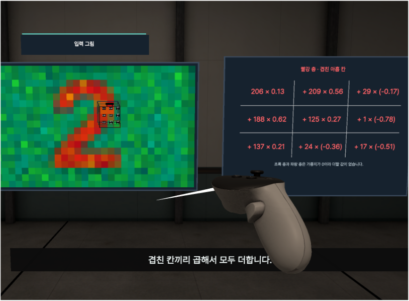
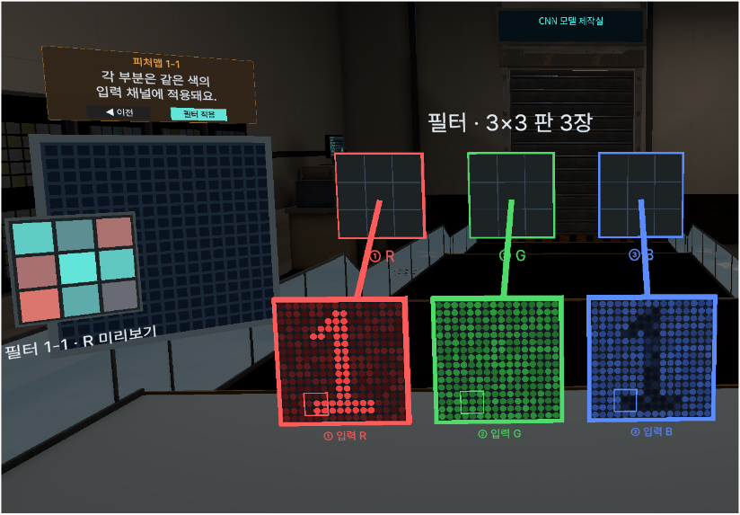
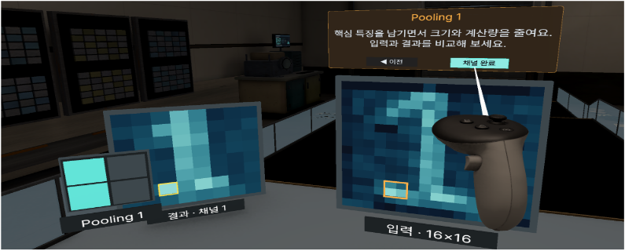
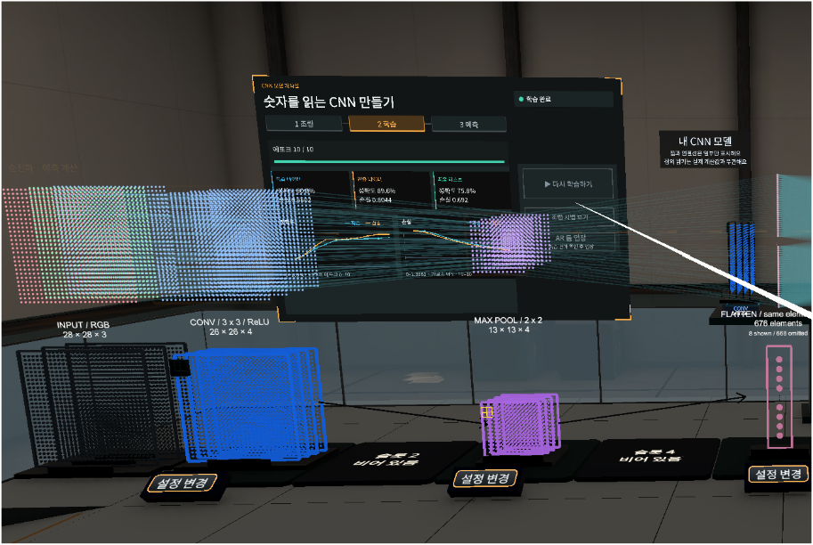

# CNN 원리 탐구 및 모델 설계 XR 교육 콘텐츠

**2026 Meta Quest 기반 차세대디스플레이 VR/XR 교육콘텐츠 경진대회**

**팀: K 디스플레이 데몬 헌터스(케디헌)**

## 프로젝트 소개

학습자가 가상 공장에서 CNN의 내부 연산을 직접 조작하며 이미지 분류의 원리를 익히고, 자신이 구성하고 학습시킨 모델을 현실의 숫자 인식에 적용하는 XR 교육 콘텐츠이다.

## 기획 배경과 필요성

디스플레이는 픽셀의 RGB 값을 통해 이미지를 표현하며, 인공지능은 이러한 수치 데이터를 입력으로 받아 이미지의 특징을 추출하고 분류한다. 본 콘텐츠는 픽셀과 RGB 값을 관찰하는 체험에서 출발하여 CNN의 연산과 이미지 인식 과정으로 학습을 확장한다. 이를 통해 디스플레이가 이미지를 표현하는 방식과 인공지능이 이미지를 해석하는 원리를 연결하여 이해하도록 한다.

CNN의 개념을 이론으로 배우더라도 내부에서 데이터가 처리되는 과정을 구체적으로 이해하기는 어렵다. 합성곱의 계산 방법을 알아도 필터의 위치가 출력 위치와 어떻게 대응하는지, 여러 특징 맵이 다음 층에서 어떻게 처리되는지 파악하는 데에는 어려움이 있다. 모델 구현 실습에서도 코드 작성과 실행에 집중하다 보면 각 레이어의 역할과 연결 관계를 충분히 살펴보지 못할 수 있다.

본 콘텐츠는 이러한 어려움을 보완하기 위해 CNN의 내부 연산과 모델 구조를 가상 공간에 입체적으로 구현하였다. 학습자는 필터를 움직이며 계산 과정을 확인하고, 레이어를 배치하여 모델을 구성한다. 이를 통해 이론으로 배운 개념을 구체적인 동작과 연결하고, CNN이 이미지의 특징을 추출하여 분류하는 과정을 이해하도록 하였다.

## 핵심 교육 아이디어

학습자가 CNN의 원리를 탐구한 뒤 모델을 직접 설계하고 현실의 입력에 적용하도록 구성하였다. 가상 공장의 각 체험실에서는 픽셀과 RGB 값, 합성곱 연산, 특징 맵과 분류 과정을 차례로 다룬다. 학습자는 필터를 입력 위에 배치하고 출력 위치를 예측한다. 이후 계산 과정과 정오답 피드백을 확인하면서 입력 영역과 출력값의 관계를 익힌다. 특징 맵 체험에서는 필터에 따라 달라지는 반응과 풀링의 역할을 살펴보고, 여러 단계의 처리가 분류 결과로 이어지는 흐름을 확인한다.

모델 설계실에서는 합성곱, 풀링, Flatten, Dense 블록을 배치하고 설정을 변경하여 모델을 구성한다. 구성 검사에서 제공하는 안내에 따라 모델을 수정한 뒤, 학습 데이터로 실제 학습을 수행한다. 학습자는 정확도와 손실, 예측 결과를 확인하고, 학습한 모델을 현실에서 촬영한 숫자에 적용한다. 이 과정에서 개별 연산에 대한 이해를 모델 전체의 동작과 연결한다.

## 학습 경험과 VR/XR 활용

| 항목 | 내용 |
| --- | --- |
| 대상 학습자 | 디스플레이의 이미지 표현 방식과 CNN 기반 이미지 인식 원리를 배우고자 하는 대학생 및 비전공자 |
| 학습목표 | 이미지의 픽셀·RGB와 숫자 행렬 표현 이해, 합성곱 연산 및 특징맵의 역할 이해, CNN 모델 구성과 이미지 인식 과정의 연결 |
| 핵심 체험 | 가상 돋보기를 활용한 픽셀·RGB 관찰, 필터 조작을 통한 합성곱 연산 체험, 필터별 특징맵 비교, CNN 모델 구성 및 결과 확인 |
| 왜 VR/XR인가? | 평면 화면에서 파악하기 어려운 픽셀 데이터와 CNN의 연산 과정을 3D 공간에 시각화하고, 학습자가 필터와 모델 구성 요소를 직접 조작하며 결과를 확인하도록 하여 추상적인 개념의 직관적 이해를 돕는다. |

## 대표 장면 또는 학습 흐름

이미지의 픽셀·RGB 관찰 → 합성곱 연산 체험 → 피쳐맵 탐색 → CNN 모델 설계 및 결과 확인

### ① 픽셀 관찰실

가상 돋보기로 이미지를 확대하여 픽셀과 RGB 값을 관찰하고, 이미지가 숫자 행렬로 표현되는 방식을 이해한다.

### ② 합성곱 연산실

커널 필터를 직접 움직이며 이미지의 각 영역에 적용되는 연산과 출력값의 변화를 확인하고, 합성곱의 원리를 익힌다.

### ③ 피쳐맵 탐색실

필터에 따라 이미지의 서로 다른 특징이 강조되는 모습을 비교하고, 합성곱 연산의 결과가 특징맵으로 구성되는 과정을 살펴본다.

### ④ CNN 모델 설계실

CNN의 구성 요소를 조합하고 결과를 확인하며, 픽셀 데이터가 연산과 특징 추출을 거쳐 이미지 인식으로 이어지는 전체 흐름을 이해한다.

## 아이디어의 차별성

본 콘텐츠는 CNN의 추상적인 연산 과정을 학습자가 직접 조작하고 결과를 확인할 수 있는 공간형 체험으로 구성한다. 필터의 위치와 종류에 따라 연산값과 특징맵이 어떻게 달라지는지 연결하여 관찰함으로써, 수식과 결과를 따로 학습할 때 파악하기 어려운 관계를 직관적으로 이해하도록 돕는다. 또한 CNN의 처리 단계를 가상 공장의 여러 체험실로 구분하여 개별 개념을 단계적으로 익히고, 마지막 모델 설계 체험에서 이를 하나의 이미지 인식 과정으로 연결한다. 디스플레이에 표현되는 픽셀·RGB 데이터에서 출발하여 AI의 특징 추출과 이미지 인식까지 탐구한다는 점에서, 이미지의 표현과 해석을 함께 배우는 융합형 교육 경험을 제공한다.

## 교육 목적 및 교과 연계

### 학습 대상과 목표

본 콘텐츠는 디스플레이 관련 교과목에서 CNN 기초 이론을 배운 대학생을 대상으로 한다. 픽셀, 필터, 층의 기본 개념을 미리 학습할 것을 권장하며, 코드 작성 경험이 없어도 3D 공간에서 관찰하고 직접 조작하며 실습에 참여할 수 있도록 구성하였다.

핵심 학습목표는 'CNN이 이미지에서 특징을 추출하고 숫자를 분류하는 과정을 입력부터 출력까지 설명할 수 있다.'이다

학습자는 픽셀의 RGB 값을 관찰하고, 합성곱 필터를 적용하고, 특징 맵과 분류 결과를 비교하고, 마지막으로 CNN 모델을 직접 조립하여 각 단계를 연결 지을 수 있다.

### 연계 교과목에 따른 교육 내용

본 콘텐츠는 이미지 데이터의 표현과 CNN의 특징 추출을 다루는 교과목에서 실습 자료로 활용할 수 있다. 이때, 연계 유형을 교과목에서 다루는 주요 내용과 XR 체험 활동의 연결 방식을 기준으로 2가지로 분류하였다.

- 직접 연계 : CNN의 구조와 연산, 특징 추출, 영상 인식 등 본 체험의 핵심 내용을 교과목의 주요 학습 주제로 다루는 경우
- 기초 연계 : 신경망의 구조와 학습 원리 등 관련 교과의 기초 개념을 관찰과 조작을 통해 보완하는 경우

연계 교과목과 주요 교육 내용은 [표 1]과 같다.

| 교과목 | 연계 유형 | 관련 교육 내용 |
| --- | --- | --- |
| 컴퓨터 비전 | 직접 연계 | 인공신경망과 숫자 인식, CNN 구조·학습 원리·수용장 및 구현 |
| 디스플레이와 AI 기술 | 직접 연계 | 머신러닝·딥러닝 기초, CNN 기본 원리와 영상 인식 |
| 인공지능수학 | 기초 연계 | 활성화함수·미분, 신경망 구조와 역전파, DNN 구현 |
| 머신러닝 활용과 실습 | 기초 연계 | CNN 구조와 학습 방법, 시계열 데이터 적용 |

[표 1] CNN 체험 콘텐츠 연계 교과목 및 주요 교육 내용

## 입체 시각화와 직접 조작의 강점

본 콘텐츠는 컴퓨터 내부에서 수치로 처리되는 CNN의 연산과 데이터 구조를 가상 공간에 펼쳐 보여준다. 학습자는 시점을 옮기며 채널별 특징 맵과 층별 배치를 살펴보고, 특징 맵의 공간 크기와 채널 수를 구분하여 비교할 수 있다.

합성곱 체험에서는 필터를 직접 배치하고 움직이며 계산에 사용되는 입력 영역을 확인한다. 픽셀값과 필터 가중치가 곱해지고 합산되는 과정을 입체 애니메이션으로 관찰하여, 수식의 각 항이 실제 입력과 출력에서 무엇을 의미하는지 연결한다.

특징 맵 체험에서는 여러 필터의 반응과 최대 풀링이 각 지역 영역에서 최댓값을 선택하는 과정을 살펴본다. 이어지는 층과 분류 결과를 공간에서 순서대로 탐색함으로써, 개별 연산을 서로 연결된 처리 과정으로 이해하도록 한다. 이러한 공간 배치와 조작은 평면 자료에서 한꺼번에 제시되는 관계를 나누어 관찰하고 다시 연결하는 학습 경험을 제공한다.

## 기대 효과

### CNN 원리 이해와 능동적 참여

학습자는 픽셀, 필터, 합성곱, 특징 맵을 입력부터 분류 결과까지 이어지는 과정으로 이해할 수 있다. 또한 모델을 구성하고 학습 결과를 확인하면서, 각 레이어의 역할과 설계 요소의 변화가 모델의 동작에 어떤 차이를 만드는지 탐구할 수 있다.

체험에서는 관찰 대상을 선택하고, 결과를 예상한 뒤 직접 조작하여 확인하는 활동을 수행한다. 이러한 경험을 통해 학습자가 설명을 듣는 데 그치지 않고 CNN의 동작에 대해 스스로 질문하고 근거를 찾아 설명하는 참여를 유도한다.

교육적 효과는 체험 후 설명과 비교 활동을 통해 확인한다. 원리 이해와 참여 증진은 본 콘텐츠의 기대 효과이며, 실제 수업 적용 결과를 바탕으로 학습자의 어려움과 개선점을 파악한다.

### 피드백과 실습 효율성

모델 구성 과정에서 제공되는 문제 위치·원인·수정 안내는 학습자가 레이어의 연결 조건을 확인하고 구성을 조정하는 데 활용한다. 학습 후에는 샘플 이미지의 정답과 예측 숫자, 숫자별 확률을 비교하며 모델이 맞힌 사례와 틀린 사례를 살펴본다. 교수자는 이러한 결과를 학습자의 설명과 연결하여 잘못 이해한 부분을 보완한다.

블록 기반 모델 구성은 레이어 정의 코드를 직접 작성하는 부담을 줄여, 초기 학습 단계에서도 구조와 역할에 집중할 수 있도록 한다. 설정 변경, 재학습, 결과 확인을 하나의 작업대에서 이어서 수행하여 설계 조건과 결과를 비교하는 활동을 지원한다.

다만 모델 변경 후에는 재학습이 필요하므로, 수업에서는 학습 대기 시간을 고려하여 실험 범위를 정한다. 효율성의 초점은 코드 작성과 실행 환경 준비의 부담을 낮추고, 개념 탐구와 결과 해석에 수업 시간을 활용하는 데 있다.

위 내용을 간략히 정리하면 다음 [표 6]과 같다.

| 학습자의 활동 | 확인하는 결과 및 피드백 | 기대 학습 효과 |
| --- | --- | --- |
| 필터 배치·이동 | 계산 영역과 출력값 | 합성곱의 입력·출력 관계 이해 |
| 층별 특징 맵 비교 | 필터별 반응과 풀링 결과 | 특징 추출과 전달 과정 이해 |
| 레이어 구성·수정 | 구성 문제와 수정 안내 | 레이어의 역할과 연결 조건 이해 |

[표 6] 체험 활동과 피드백에 따른 기대 교육 효과
